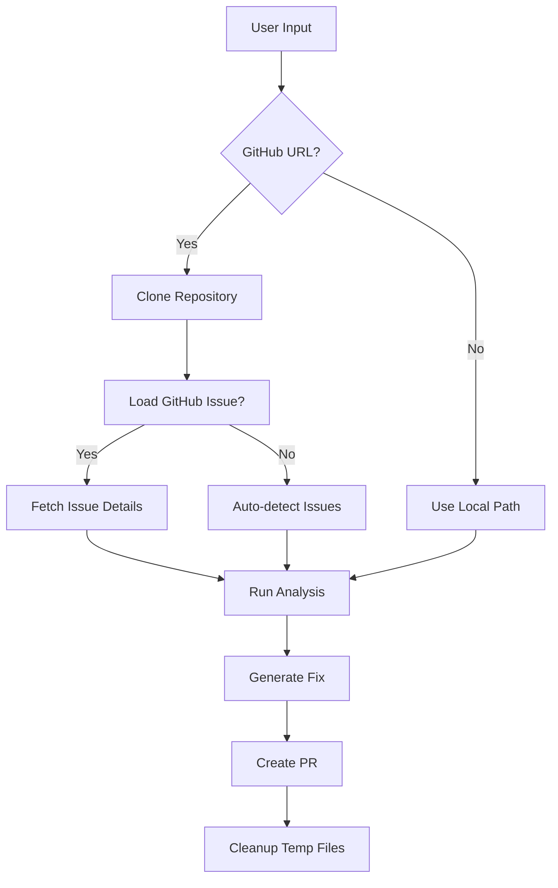

# 🚀 DevMind GitHub Integration

DevMind now supports **remote GitHub repositories** - no local cloning required! Work with any public or private GitHub repository directly.

## 🌟 New Features

### 📦 **Remote Repository Support**
- **GitHub URLs**: `https://github.com/owner/repo`
- **SSH URLs**: `git@github.com:owner/repo.git`  
- **Owner/Repo**: `owner/repository`
- **Local Paths**: `/path/to/local/repo` (existing functionality)

### 🐛 **GitHub Issues Integration**
- Automatically load GitHub issues by number
- Parse issue descriptions, labels, and comments
- Work with issue context for targeted fixes

### 🔄 **Automatic Repository Management**
- Auto-clone repositories to temporary directories
- Smart cleanup after analysis completion
- Support for private repositories with GitHub tokens

## 💻 Usage Examples

### Example 1: Analyze a Public Repository
```
Repository Location: https://github.com/microsoft/vscode
GitHub Issue #: 1234
```

### Example 2: Work with Owner/Repo Format
```
Repository Location: facebook/react
Issue Description: useState hook not updating properly
```

### Example 3: Private Repository with Issue
```
Repository Location: myorg/private-repo
GitHub Repository: myorg/private-repo
GitHub Issue #: 42
```

## 🔧 Configuration

### GitHub Token Setup
Add your GitHub token to `.env`:
```env
GITHUB_TOKEN=ghp_your_token_here
```

**Token Permissions Required:**
- `repo` (for private repositories)
- `public_repo` (for public repositories)
- `issues` (to read GitHub issues)

### API Endpoints

#### Get Repository Info
```
GET /github/info/{owner}/{repo}
```

#### List Open Issues  
```
GET /github/issues/{owner}/{repo}?limit=10
```

#### Get Issue Details
```
GET /github/issue/{owner}/{repo}/{issue_number}
```

## 🛠️ How It Works

1. **Input Detection**: DevMind detects if input is GitHub URL or local path
2. **Repository Cloning**: If GitHub repo, automatically clones to temp directory
3. **Issue Loading**: If issue number provided, fetches from GitHub API
4. **Analysis**: Runs standard code analysis workflow
5. **PR Creation**: Creates pull request back to original repository
6. **Cleanup**: Removes temporary directories after completion

## 📊 Workflow



## 🎯 Benefits

- ✅ **No Local Setup**: Work with repos without cloning locally
- ✅ **Issue Integration**: Direct GitHub issue context 
- ✅ **Private Repo Support**: Works with private repositories
- ✅ **Auto PR Creation**: Seamless contribution workflow
- ✅ **Smart Cleanup**: No disk space waste
- ✅ **Backward Compatible**: Local paths still work

## 🔍 Example UI Workflow

1. **Paste GitHub URL**: `https://github.com/owner/awesome-project`
2. **Enter Issue Number**: `#123` (optional)
3. **Click "Run Analysis"**: DevMind clones, analyzes, and generates fix
4. **Review & Approve**: Creates PR automatically to original repo

---

**DevMind** - Now with seamless GitHub integration! 🎉